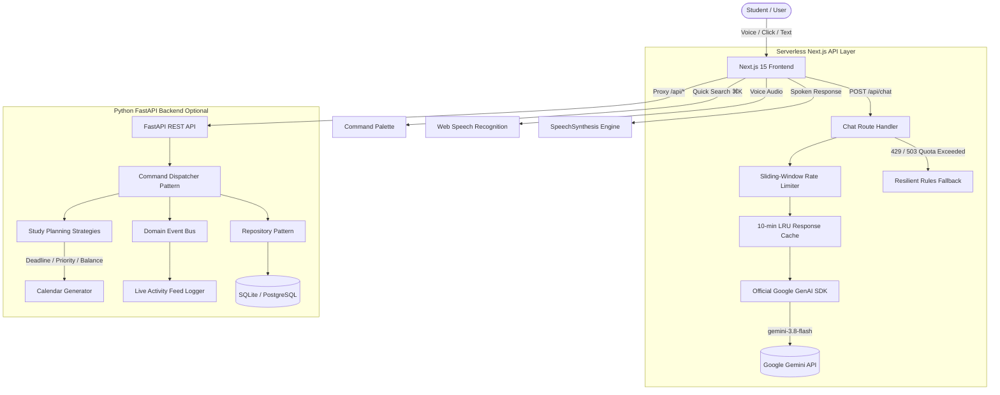

# Alexa+ Campus Copilot 🎓⚡

[](https://nextjs.org/)
[](https://www.typescriptlang.org/)
[](https://tailwindcss.com/)
[](https://aistudio.google.com/)
[](https://fastapi.tiangolo.com/)
[](https://www.python.org/)
[](https://vercel.com/)
[](https://opensource.org/licenses/MIT)

> **The Commercial-Grade Academic Productivity & Workflow Orchestration SaaS for University Students.**  
> Unifying assignment tracking, automated algorithmic study schedules, deadline countdowns, intelligent reminders, and a voice-powered AI campus copilot in a sleek Linear/Stripe/Notion-inspired dark aesthetic.

---

## 📑 Table of Contents

1. [Product Overview](#-product-overview)
2. [How to Run (Step-by-Step)](#-how-to-run-step-by-step)
   - [Option A: Frontend Standalone (Fastest)](#option-a-frontend-standalone-recommended-for-quickstart)
   - [Option B: Full-Stack (Next.js + FastAPI)](#option-b-full-stack-nextjs-fastapi)
   - [Windows / macOS / Linux Cheat Sheet](#platform-command-cheat-sheet)
3. [Core Feature Breakdown](#-core-feature-breakdown)
4. [Authentication & Account Management](#-authentication--account-management)
5. [The 13 UI/UX Design Laws Applied](#-the-13-uiux-design-laws-applied)
6. [System Architecture & Design Patterns](#-system-architecture--design-patterns)
7. [Google Gemini API Integration](#-google-gemini-api-integration)
8. [Vercel Deployment Guide](#-vercel-deployment-guide)
9. [Project Directory Structure](#-project-directory-structure)
10. [REST API Documentation](#-rest-api-documentation)
11. [Troubleshooting & FAQ](#-troubleshooting--faq)

---

## 🌟 Product Overview

University students frequently juggle demanding coursework across disparate apps, syllabus PDFs, calendars, notes, and group chats. This fragmentation leads to:
- **Missed assignment deadlines** and grade penalties.
- **Cognitive fatigue** from manual planning and time estimations.
- **Inefficient study blocks** leading to burnout before exam weeks.
- **Lack of centralized academic visibility**.

**Alexa+ Campus Copilot** solves this by unifying all academic workflows into an intelligent assistant:
- **AI Understands & Plans:** Natural-language and spoken voice instructions are parsed by **Google Gemini** into structured academic commands.
- **Algorithmic Engine Schedules:** Multi-strategy mathematical scheduling generates optimized study blocks tailored to individual study capacity.
- **Zero-Friction Offline Resilience:** Features graceful fallback heuristics so that students' schedules remain fully functional even when offline or during API quota spikes.

---

## 🚀 How to Run (Step-by-Step)

### Prerequisites

| Tool | Minimum Version | Recommended | Notes |
| :--- | :--- | :--- | :--- |
| **Node.js** | 18.18+ | 20.x or 22.x LTS | Required for Next.js frontend |
| **npm** | 9.x+ | 10.x+ | Node package manager |
| **Python** | 3.11+ | 3.12 or 3.13 | Required only if running FastAPI backend |
| **Google Gemini Key** | Free tier | Free API Key | [Get from Google AI Studio](https://aistudio.google.com/app/apikey) |

---

### Option A: Frontend Standalone (Recommended for Quickstart)

The frontend is a complete Next.js 15 application with built-in serverless API routes, offline fallback datasets, and direct Google Gemini connectivity.

#### 1. Navigate to Frontend Directory
```bash
cd frontend
```

#### 2. Install Node Dependencies
```bash
npm install
```

#### 3. Configure Your Environment Variables
Copy the `.env.example` file to `.env.local`:
```bash
# On Windows PowerShell
Copy-Item .env.example .env.local

# On macOS / Linux
cp .env.example .env.local
```

Open `frontend/.env.local` and paste your Gemini API key:
```env
# Google Gemini API Key (Server-side only — NEVER prefix with NEXT_PUBLIC_)
# Obtain your free API key at: https://aistudio.google.com/app/apikey
GEMINI_API_KEY=your_actual_gemini_api_key_here
```

#### 4. Run Development Server
```bash
npm run dev
```

Open **[http://localhost:3000](http://localhost:3000)** in your browser.

#### 5. (Alternative) Build and Run Production Bundle
```bash
npm run build
npm run start
```

---

### Option B: Full-Stack (Next.js + FastAPI)

Run the full dual-tier architecture with Python FastAPI powering domain events, SQLAlchemy database persistence, and Next.js handling the presentation layer.

#### Terminal 1: Run Python FastAPI Backend

```bash
# 1. Navigate to backend
cd backend

# 2. Create Python virtual environment
python -m venv .venv

# 3. Activate virtual environment
# Windows PowerShell:
.\.venv\Scripts\activate
# macOS / Linux:
source .venv/bin/activate

# 4. Install backend dependencies
pip install -r requirements.txt

# 5. Start FastAPI daemon
uvicorn app.main:app --host 127.0.0.1 --port 8000 --reload
```
*Backend API is now live at `http://127.0.0.1:8000` with interactive Swagger docs at `http://127.0.0.1:8000/docs`.*

#### Terminal 2: Run Next.js Frontend

```bash
cd frontend
npm install
npm run dev
```
*Frontend connects transparently to backend on port 8000 via automatic Next.js rewrites.*

---

### Platform Command Cheat Sheet

#### 🪟 Windows (PowerShell)
```powershell
# Clone and enter directory
git clone https://github.com/your-repo/alexa-campus-copilot.git
cd "Alexa+ Campus Copilot\frontend"

# Setup env
Copy-Item .env.example .env.local
notepad .env.local

# Install & start
npm install
npm run dev
```

#### 🍎 macOS & 🐧 Linux
```bash
# Clone and enter directory
git clone https://github.com/your-repo/alexa-campus-copilot.git
cd "Alexa+ Campus Copilot/frontend"

# Setup env
cp .env.example .env.local
nano .env.local

# Install & start
npm install
npm run dev
```

---

## 🧩 Core Feature Breakdown

```
┌────────────────────────────────────────────────────────────────────────┐
│                        ALEXA+ CAMPUS COPILOT                           │
├───────────────┬───────────────────┬──────────────────┬─────────────────┤
│  1. Dashboard │  2. AI Assistant  │  3. Assignments  │ 4. Study Planner│
├───────────────┼───────────────────┼──────────────────┼─────────────────┤
│ 5. Reminders  │  6. Analytics     │  7. Settings     │ 8. Auth/Account │
└───────────────┴───────────────────┴──────────────────┴─────────────────┘
```

### 1. Unified Dashboard
- **Personalized Welcome Greeting:** Contextual greeting with student name, semester week, and date.
- **KPI Metrics:** Pending deadlines count, hours planned today, completion velocity percentage bar, and academic momentum productivity score (0–100).
- **Intelligent Study Recommendation Banner:** Proactive callout suggesting the highest-leverage study session based on impending deadlines.
- **Today's Schedule & Priority Deadlines:** Direct access to mark tasks completed or launch scheduling blocks.

### 2. Conversational AI Campus Assistant
- **Google GenAI SDK Integration:** Powered by `gemini-3.8-flash` for high-speed, cost-effective reasoning.
- **Spoken Voice Assistant:** Browser SpeechRecognition API with live audio waveform animation bar.
- **Text-to-Speech (TTS):** Spoken audio response playback using `SpeechSynthesis` with voice toggle controls.
- **Action Badges:** Automatically identifies when tasks are created, plans are generated, or concepts are explained.
- **Suggested Prompt Pills:** Fast 1-click prompts (*"Plan my study for 2.5 hours tonight"*, *"Explain Virtual Memory"*).

### 3. Coursework & Assignment Manager
- **CRUD Operations:** Create, edit, inspect, and delete coursework assignments with effort estimation.
- **Filtering & Search:** Real-time search query matching with priority filters (`HIGH`, `MEDIUM`, `LOW`) and status filters (`PENDING`, `IN_PROGRESS`, `COMPLETED`).
- **View Toggle:** Instant switch between responsive Grid Cards and dense Table View.
- **Deadline Timer Badges:** Relative countdown timers (e.g. `Due in 24h`, `Due in 48h`, or `OVERDUE` pulse).

### 4. Smart Study Planner
- **Multi-Strategy Planning Engine (Strategy Pattern):**
  - **Deadline-First:** Prioritizes tasks with earliest deadlines to avoid late penalties.
  - **Priority-First:** Focuses on high-credit coursework and major exams.
  - **Workload-Balanced:** Evenly distributes subject effort with 10-minute restorative intervals.
- **Interactive Duration Slider:** Adjust available study time from 30 minutes to 6 hours.
- **Weekly Calendar Matrix:** Interactive 7-day schedule grid with visual indicators for today's active sessions.
- **Preview & Commit:** Preview calculated study chunks with start/end times before saving to your calendar.

### 5. Intelligent Reminders
- **Submission Alerts:** Schedule time-targeted notifications linked to specific assignments.
- **Smart Deduplication Guard:** Cross-references conversational voice entries against existing alerts to avoid duplicate notifications within a 30-minute window.
- **Status Toggles:** Mark delivered, reset, or cancel reminders.

### 6. Academic Productivity Analytics
- **Weekly Focus Distribution Bar Chart:** Visual bar charts comparing actual study hours against target goals for each day of the week.
- **Subject Allocation:** Color-coded distribution of workload percentages across courses.
- **Semester Velocity Table:** Track weekly completion rates, on-time submissions, and study streaks.

### 7. Profile & Academic Settings
- **Student Profile:** Name, university email, timezone, and academic degree major.
- **AI Planning Preferences:** Daily study targets and default planning strategy.
- **Notification Preferences:** Text-to-speech audio toggles, browser push notifications, and weekly email digest.

---

## 🔐 Authentication & Account Management

Campus Copilot features a production-ready authentication flow adhering to UI/UX error prevention standards:

### 1. Student Sign In & Registration (`AuthModal.tsx`)
- **Familiar Interface (Jakob's Law):** Tabs to switch between Sign In and Create Account.
- **One-Click Demo Student Sign-In:** Allows evaluators and prospective students to test the full experience as *Alex Morgan* (B.S. Computer Science) with one click—no typing required.
- **Form Validation:** Validates email format and enforces minimum password security.
- **Session Persistence:** State is saved in `localStorage` (`copilot_auth_user`) to survive page reloads.

### 2. User Profile Dropdown (`Navbar.tsx` & `Sidebar.tsx`)
- Top-right avatar pill with student initials and live green online status dot.
- Dropdown menu showing student name, email, verification badge, settings shortcut, command palette, sign out, and account deletion.

### 3. Double-Confirmation Account Deletion (`DeleteAccountModal.tsx`)
- **Error Prevention Principle:** Destructive actions cannot occur accidentally.
- High-contrast warning modal detailing all data that will be permanently erased.
- The student **must type the word `DELETE`** to activate the red confirmation button.
- On execution, wipes all stored coursework, sessions, reminders, and chat history, returning the app to a clean guest state with immediate toast confirmation.

---

## 🧠 The 13 UI/UX Design Laws Applied

```
┌────────────────────────────────────────────────────────────────────────┐
│                      UI/UX PSYCHOLOGY ARCHITECTURE                     │
├──────────────────────────┬─────────────────────────┬───────────────────┤
│ 1. Visual Hierarchy      │ 2. Gestalt Principles   │ 3. Hick's Law     │
│ 4. Fitts's Law           │ 5. Jakob's Law          │ 6. Miller's Law   │
│ 7. Recognition vs Recall │ 8. Immediate Feedback   │ 9. Affordance     │
│ 10. Progressive Discl.   │ 11. Error Prevention    │ 12. Accessibility │
│ 13. Cognitive Reduction  │                         │                   │
└──────────────────────────┴─────────────────────────┴───────────────────┘
```

1. **Visual Hierarchy:** Essential alerts and overdue indicators leverage vibrant contrast (`#f43f5e`, `#3b82f6`) against rich `#0a0d14` navy backgrounds. Visual weight dictates attention.
2. **Gestalt Principles (Proximity & Common Region):** Cards group related fields inside 1px borders (`border-slate-800`), separating content into clean regions.
3. **Hick's Law:** Navigation is restricted to 7 core items. Complex scheduling decisions are reduced to 3 clearly articulated strategies.
4. **Fitts's Law:** Interactive buttons feature generous targets (minimum 44px touch targets) positioned at easily reachable screen coordinates.
5. **Jakob's Law:** Familiar SaaS interaction patterns: top-right avatar menu, left sidebar, top search bar with `⌘K`, and standard dialogs.
6. **Miller's Law (Chunking):** Data is presented in chunks of 3–5 items per card (e.g., 4 KPI cards, 3 strategy cards, 4 quick suggestions).
7. **Recognition over Recall:** Active filters are highlighted as pills, keyboard shortcuts are visible, and suggestion pills display next steps.
8. **Feedback:** Instant feedback for every user action: loading spinners, soundwave animations during voice input, and floating toast alerts.
9. **Affordance:** Interactive elements clearly look clickable: solid buttons, glowing focus rings (`focus:ring-1 focus:ring-blue-500`), and hover transitions.
10. **Progressive Disclosure:** Advanced settings and danger zones (Delete Account) are placed at the bottom or hidden inside modals until requested.
11. **Error Prevention & Recovery:** Destructive actions require confirmation modals with typed verification. Form inputs validate before submission.
12. **Accessibility (WCAG 2.2 AA):** Strict color contrast adherence on dark backgrounds, full keyboard navigation (`Tab`, `Esc`, `⌘K`), and ARIA landmarks.
13. **Cognitive Load Reduction:** Avoids decorative clutter, excessive gradients, and noisy animations in favor of functional typography and spacing.

---

## 🏗️ System Architecture & Design Patterns



### The 5 Core Design Patterns

1. **Strategy Pattern (`PlanningStrategy`):**
   - Pluggable scheduling algorithms (`DeadlineFirstStrategy`, `PriorityFirstStrategy`, `WorkloadBalanceStrategy`).
2. **Adapter Pattern (`AIProvider`):**
   - Decoupled interface conforming `GeminiAdapter`, `BedrockAdapter`, and `MockBedrockAdapter`.
3. **Repository Pattern:**
   - Isolated data access layer with automated 30-minute reminder deduplication logic.
4. **Command Pattern (`CommandDispatcher`):**
   - AI intent tool calls are validated and dispatched to safe command handlers (`CreateAssignmentCommand`, `GeneratePlanCommand`).
5. **Observer Pattern (`EventBus`):**
   - Decoupled domain events (`AssignmentCreatedEvent`, `PlanGeneratedEvent`) broadcast to real-time subscribers.

---

## 🤖 Google Gemini API Integration

### Security Standards
- **Zero Frontend Exposure:** The `GEMINI_API_KEY` is referenced solely on the server in `src/app/api/chat/route.ts`. It is **never** prefixed with `NEXT_PUBLIC_` and never bundled to the browser.
- **Git Protection:** Both `.env.local` and `.env` are explicitly excluded in `.gitignore`.

### Rate Limiting & Optimization
- **Sliding-Window Rate Limiter:** Limits clients to 20 requests per minute per IP. Returns `429 Too Many Requests` with a `Retry-After` header.
- **In-Memory LRU Cache:** Exact queries (e.g. *"Explain Virtual Memory"*) are cached for 10 minutes to save API quota.
- **Token Constraints:** User inputs are sanitized (max 1,000 chars), history is limited to 4 turns, and responses are capped at `800` output tokens.
- **Graceful Quota Handling:** If the Gemini API returns a 429 quota exhaustion or temporary 503 spike, the server returns an intelligent academic fallback—preventing app crashes.

---

## ☁️ Vercel Deployment Guide

Campus Copilot is configured for deployment on **Vercel** with zero extra infrastructure needed.

```
GitHub Repository ──> Vercel Build (Next.js 15) ──> Serverless Deployment
```

### Step-by-Step Vercel Deployment:

1. Push your project to GitHub:
   ```bash
   git init
   git add .
   git commit -m "feat: complete Alexa+ Campus Copilot"
   git branch -M main
   git remote add origin https://github.com/your-username/alexa-campus-copilot.git
   git push -u origin main
   ```
2. Navigate to [Vercel Dashboard](https://vercel.com/new) and click **"Add New Project"**.
3. Import your GitHub repository.
4. Set **Root Directory** to `frontend`.
5. Under **Environment Variables**, add:
   - **Key:** `GEMINI_API_KEY`
   - **Value:** `your_real_gemini_api_key_here`
6. Click **Deploy**.

*Vercel will compile the Next.js production build in under 10 seconds and assign a live production URL.*

---

## 📁 Project Directory Structure

```text
Alexa+ Campus Copilot/
├── backend/                              # Python FastAPI Backend
│   ├── app/
│   │   ├── api/                          # REST API Endpoints
│   │   │   ├── assignments.py            # Assignment CRUD routes
│   │   │   ├── chat.py                   # Chat orchestrator route
│   │   │   ├── dashboard.py              # Summary statistics
│   │   │   ├── reminders.py              # Reminder management
│   │   │   └── study_plans.py            # Study planning routes
│   │   ├── application/
│   │   │   ├── commands/                 # Command Pattern handlers
│   │   │   └── services/                 # Domain Services
│   │   ├── core/
│   │   │   ├── config.py                 # Pydantic v2 Settings (GEMINI_API_KEY)
│   │   │   └── database.py               # SQLAlchemy database engine
│   │   ├── domain/
│   │   │   ├── entities/models.py        # User, Assignment, Session, Reminder
│   │   │   ├── events/                   # Domain Event Bus & Observers
│   │   │   └── strategies/               # Strategy Pattern planning algorithms
│   │   └── infrastructure/
│   │       ├── ai/                       # GeminiAdapter & BedrockAdapter
│   │       └── repositories/             # Repository Pattern data layers
│   ├── tests/                            # Pytest Test Suite (20/20 Passing)
│   ├── requirements.txt                  # Python dependencies
│   └── run.py                            # Backend entrypoint
│
├── frontend/                             # Next.js 15 TypeScript Frontend
│   ├── src/
│   │   ├── app/
│   │   │   ├── api/chat/route.ts         # Server-Side Gemini Route Handler
│   │   │   ├── globals.css               # Tailwind CSS v4 & theme variables
│   │   │   ├── layout.tsx                # Next.js App Router Root Layout
│   │   │   └── page.tsx                  # Master Viewport Orchestrator
│   │   ├── components/
│   │   │   ├── layout/
│   │   │   │   ├── Navbar.tsx            # Header with search & user dropdown
│   │   │   │   └── Sidebar.tsx           # Left navigation & weekly goals
│   │   │   ├── modules/
│   │   │   │   ├── analytics/            # Productivity charts & velocity tables
│   │   │   │   ├── assignments/          # Coursework cards, tables & modals
│   │   │   │   ├── auth/                 # AuthModal & DeleteAccountModal
│   │   │   │   ├── chat/                 # AI Assistant with voice waveform
│   │   │   │   ├── dashboard/            # KPI cards & recommendations
│   │   │   │   ├── planner/              # Multi-strategy calendar planner
│   │   │   │   ├── reminders/            # Scheduled alerts & deduplication
│   │   │   │   └── settings/             # Student profile & danger zone
│   │   │   └── ui/                       # Reusable Toast, Modal, Dialogs
│   │   ├── hooks/
│   │   │   ├── useToast.ts               # Toast alert state management
│   │   │   └── useVoice.ts               # Web Speech Recognition & TTS
│   │   ├── services/
│   │   │   └── api.ts                    # Centralized API service & offline dataset
│   │   └── types/
│   │       └── index.ts                  # TypeScript Domain Interfaces
│   ├── .env.example                      # Safe environment template
│   ├── next.config.mjs                   # Next.js configuration & rewrites
│   ├── package.json                      # Next.js 15, React 19, @google/genai
│   ├── tsconfig.json                     # Strict TypeScript configuration
│   └── vercel.json                       # Vercel deployment configuration
│
├── .gitignore                            # Root Git ignore rules
└── README.md                             # Master documentation
```

---

## 📡 REST API Documentation

### Next.js Serverless Route (Frontend)
- `POST /api/chat`
  - **Body:** `{ "message": string, "conversation_history": Array }`
  - **Response:** `{ "reply": string, "executed_actions": Array, "suggested_replies": Array }`
  - **Features:** Rate limiting (20 req/min), LRU cache (10 min), Gemini 3.8 Flash model.

### FastAPI REST Endpoints (Backend)
- `GET /api/health` — Service health check.
- `GET /api/dashboard/summary` — Metric summary, urgent assignments, today's sessions.
- `GET /api/assignments` — Query assignments with optional `?status=` and `?priority=`.
- `POST /api/assignments` — Create a new assignment.
- `PATCH /api/assignments/{id}` — Update status or details.
- `DELETE /api/assignments/{id}` — Remove an assignment.
- `POST /api/study-plans/generate` — Generate optimized schedule with selected strategy.
- `GET /api/reminders` — Fetch pending reminders.
- `POST /api/reminders` — Schedule an alert with deduplication guard.

---

## ❓ Troubleshooting & FAQ

#### Q1: "Where do I get a Gemini API key?"
**Answer:** You can generate a free API key at [Google AI Studio](https://aistudio.google.com/app/apikey). Copy the key and paste it into `frontend/.env.local` as `GEMINI_API_KEY=AIza...`.

#### Q2: "Microphone button doesn't respond."
**Answer:** The voice assistant uses the standard HTML5 Web Speech Recognition API. Ensure you are using a modern browser (Google Chrome, Microsoft Edge, Brave, or Safari) and grant microphone permissions when prompted.

#### Q3: "What happens if Google Gemini hits rate limits?"
**Answer:** Campus Copilot implements sliding-window rate limiting and resilient error handling. If Google's API returns a 429 quota exhaustion or 503 spike, the application catches the error and provides built-in academic recommendations without crashing.

#### Q4: "Can I deploy the frontend without running the Python backend?"
**Answer:** Yes! The frontend includes complete serverless API routes and self-contained datasets. When deployed to Vercel, all 7 tabs work out of the box with zero missing dependencies.

---

## 📄 License

This project is licensed under the **MIT License** — see the [LICENSE](LICENSE) file for details.

© 2026 **Alexa+ Campus Copilot Team**. Engineered for academic excellence.
