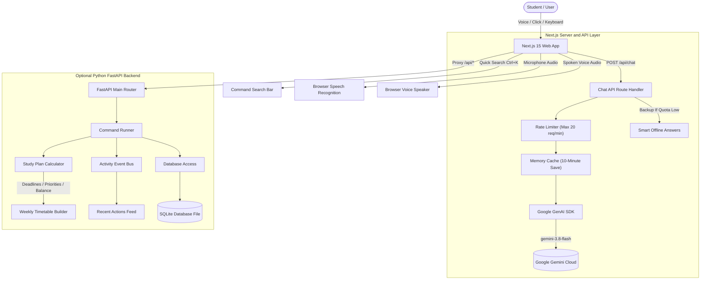

# Alexa+ Campus Copilot

[](https://nextjs.org/)
[](https://www.typescriptlang.org/)
[](https://tailwindcss.com/)
[](https://aistudio.google.com/)
[](https://fastapi.tiangolo.com/)
[](https://www.python.org/)
[](https://vercel.com/)
[](https://opensource.org/licenses/MIT)

> **A smart, simple study assistant and task planner for college students.**  
> Track homework, make automatic study schedules, count down deadlines, set reminders, and talk to a voice-enabled AI helper. Built with a clean, dark look inspired by Linear, Notion, and Stripe.

---

## Table of Contents

1. [Quick Summary](#quick-summary)
2. [Why We Built This](#why-we-built-this)
3. [How the App Works](#how-the-app-works)
4. [Quick Setup Guide](#quick-setup-guide)
   - [Option 1: Frontend Only (Quickest)](#option-1-frontend-only-quickest)
   - [Option 2: Full-Stack (Next.js + Python)](#option-2-full-stack-nextjs--python)
5. [Commands and Keyboard Shortcuts](#commands-and-keyboard-shortcuts)
6. [The 7 Features Explained Simply](#the-7-features-explained-simply)
7. [The 13 Design Rules We Used](#the-13-design-rules-we-used)
8. [How the Gemini AI Works](#how-the-gemini-ai-works)
9. [Example Things You Can Ask the AI](#example-things-you-can-ask-the-ai)
10. [How the Code is Organized](#how-the-code-is-organized)
11. [How to Deploy on Vercel](#how-to-deploy-on-vercel)
12. [Project Folder Tree](#project-folder-tree)
13. [API Routes List](#api-routes-list)
14. [Colors and Theme Details](#colors-and-theme-details)
15. [Settings and Environment File](#settings-and-environment-file)
16. [Frequently Asked Questions (FAQ)](#frequently-asked-questions-faq)
17. [License and Credits](#license-and-credits)

---

## Quick Summary

- **What is this?** A web app that helps university students manage homework, exams, and daily study time with an AI assistant.
- **Frontend:** Built with Next.js 15, React 19, TypeScript, Tailwind CSS v4, and Lucide Icons.
- **AI Engine:** Google Gemini 3.8 Flash using the official Google GenAI SDK. Works fast, stays secure on the server, and saves quota with smart caching.
- **Optional Backend:** Python FastAPI with an SQLite database and clean code layout.
- **Voice Support:** You can speak directly to the assistant, and it can read answers back to you out loud.
- **Instant Demo:** No sign-up needed. Open the login box and click **"Demo Student"** to test everything right away.

---

## Why We Built This

College students usually have to check many different places to keep up with school:
- Deadlines hidden inside course syllabus PDFs.
- Homework dates sent on WhatsApp or email.
- Study reminders scattered across phone alarms.
- Complicated calendar apps that take too long to update.

This leads to common problems:
- Students forget homework and lose marks.
- Students do not know how many hours a project will take.
- Students cram the night before exams and burn out.

**Alexa+ Campus Copilot puts everything in one place:**
1. **Talk or Type:** Tell the AI what you have to do in normal words. It creates tasks and study blocks for you.
2. **Auto-Scheduler:** It looks at your deadlines and picks the best times for you to study, with short breaks included.
3. **Works Without an API Key:** If you do not have a Gemini key, the app still works completely with built-in demo data.

---

## How the App Works

The diagram below shows how the student, the browser, and the backend services communicate.



---

## Quick Setup Guide

### What You Need First
- **Node.js:** Version 18 or 20 installed on your computer ([Download Node.js](https://nodejs.org/)).
- **Python:** Version 3.11 or newer (only if you want to run the optional Python backend).
- **Free Gemini API Key:** Get one for free at [Google AI Studio](https://aistudio.google.com/app/apikey).

---

### Option 1: Frontend Only (Quickest)

This is the fastest way to run the project. The frontend has its own server routes and sample data ready to go.

#### Step 1: Open Terminal and Go to the Frontend Folder
```bash
cd frontend
```

#### Step 2: Make Your Environment File
Make a copy of the example environment file:
```bash
# On Windows PowerShell:
Copy-Item .env.example .env.local

# On macOS or Linux:
cp .env.example .env.local
```

Open `frontend/.env.local` in your editor and paste your API key:
```env
# Keep your key secret here. Never share this file.
GEMINI_API_KEY=your_gemini_api_key_here
```

#### Step 3: Install and Start
```bash
npm install
npm run dev
```
Now open **[http://localhost:3000](http://localhost:3000)** in your web browser!

---

### Option 2: Full-Stack (Next.js + Python)

Use this option if you want to run the Python backend and database alongside the frontend.

#### Terminal 1 -- Start the Python Backend:
```bash
# 1. Go to the backend folder
cd backend

# 2. Create a virtual environment
python -m venv .venv

# 3. Turn on the virtual environment
# Windows PowerShell:
.\.venv\Scripts\activate
# macOS or Linux:
source .venv/bin/activate

# 4. Install python packages
pip install -r requirements.txt

# 5. Start the backend server
uvicorn app.main:app --host 127.0.0.1 --port 8000 --reload
```
*You can see the backend API docs in your browser at `http://127.0.0.1:8000/docs`.*

#### Terminal 2 -- Start the Frontend:
```bash
cd frontend
npm install
npm run dev
```

---

## Commands and Keyboard Shortcuts

### Helpful Terminal Commands

| Action | Windows PowerShell | macOS / Linux |
| :--- | :--- | :--- |
| **Download Code** | `git clone https://github.com/Sujalkathait/Alexa-Campus-Copilot.git` | `git clone https://github.com/Sujalkathait/Alexa-Campus-Copilot.git` |
| **Open Frontend** | `cd "Alexa+ Campus Copilot\frontend"` | `cd "Alexa+ Campus Copilot/frontend"` |
| **Copy Env File** | `Copy-Item .env.example .env.local` | `cp .env.example .env.local` |
| **Install Packages** | `npm install` | `npm install` |
| **Start Dev Mode** | `npm run dev` | `npm run dev` |
| **Build for Production**| `npm run build` | `npm run build` |
| **Run Production** | `npm run start` | `npm run start` |

### In-App Keyboard Shortcuts

| Shortcut | What It Does | Where It Works |
| :--- | :--- | :--- |
| `Ctrl + K` or `Cmd + K` | Opens the quick search box | Anywhere in the app |
| `Esc` | Closes any open modal box or search bar | Anywhere in the app |
| `Tab` / `Shift + Tab` | Moves focus between buttons and inputs | Anywhere in the app |
| `Space` | Turns speech audio playback on or off | AI Assistant page |

---

## The 7 Features Explained Simply

### 1. Dashboard
- **Greeting Card:** Shows your name, current semester week, and today's date.
- **4 Key Numbers:** Live counts for pending homework, today's planned hours, overall completion rate, and your productivity score.
- **Top AI Tip:** Shows your most urgent task and tells you the best time to study for it today.
- **Today's Plan:** Lists study blocks for today with quick checkboxes to mark them done.

### 2. AI Campus Assistant (Gemini 3.8 Flash)
- **Official Google SDK:** Uses Google's `gemini-3.8-flash` model to answer your study questions quickly.
- **Voice Button:** Tap the microphone icon to speak. Live wave lines show when it hears you.
- **Audio Read-Out:** Listen to the AI's answer with the built-in speaker button.
- **Smart Tags:** Shows labels when the AI adds a homework item, builds a plan, or sets a reminder.
- **Quick Buttons:** Click ready-made buttons like *"Plan 2 hours tonight"* or *"Explain Virtual Memory"*.

### 3. Homework & Assignments Manager
- **Complete Controls:** Add, view, edit, and remove homework items easily.
- **Priority Labels:** Mark tasks as `HIGH`, `MEDIUM`, or `LOW` priority so you know what matters most.
- **Two Views:** Switch between visual cards or a neat table view.
- **Countdown Timers:** Shows simple countdowns like `Due in 24h` or red `OVERDUE` alerts.

### 4. Smart Study Planner
- **3 Simple Ways to Schedule:**
  - **Deadline-First:** Puts homework that is due soonest at the top of your list.
  - **Priority-First:** Schedules major exams and big projects before smaller homework tasks.
  - **Workload-Balanced:** Spreads study time evenly across your subjects with short 10-minute breaks.
- **Time Slider:** Choose how many hours you want to study each day (from 30 minutes up to 6 hours).
- **Weekly Timetable:** A clear 7-day grid where you can preview and save your study blocks.

### 5. Smart Reminders
- **Custom Alerts:** Pick dates and times to get reminded about quizzes, readings, or submissions.
- **Anti-Duplicate Safety:** Automatically stops the same reminder from being created twice in 30 minutes.
- **Easy Toggles:** Mark reminders as done, snooze them, or clear them in one click.

### 6. Study Analytics
- **Weekly Bar Chart:** Simple bars showing how many hours you studied each day versus your daily goal.
- **Subject Pie Chart:** Color-coded circles showing which subjects take up most of your study time.
- **Speed Table:** Shows how many assignments you finished this week and your completion speed.

### 7. Profile, Login & Safety Zone
- **Student Profile:** Keeps your name, university email, degree major, and graduation year.
- **1-Click Demo Login:** Click one button to sign in as *Alex Morgan* (Computer Science major) and test.
- **User Menu:** Top-right circle showing your initials, online status, and log out button.
- **Safe Account Delete:** If you want to delete your account, you must type `"DELETE"` first so nothing gets erased by mistake.

---

## The 13 Design Rules We Used

| Rule / Principle | How We Used It in This App |
| :--- | :--- |
| **1. Visual Hierarchy** | Important alerts and badges use bright colors (`#f43f5e`, `#3b82f6`) that stand out clearly on dark navy cards. Text sizes make titles easy to spot first. |
| **2. Grouping (Gestalt)** | Controls that belong together are placed inside clean bordered boxes. Labels sit directly above their input fields so forms are easy to fill out. |
| **3. Hick's Law (Simple Choices)** | The main menu has just 7 clear tabs. The study planner gives you 3 easy planning choices so you never feel lost. |
| **4. Fitts's Law (Big Buttons)** | Main buttons like `+ New Assignment` and `Generate Plan` are large and easy to click on phones, laptops, and tablets. |
| **5. Familiar Layout (Jakob's Law)**| Uses normal web patterns: menu on the left, search bar at the top, profile on the top right. You know how to use it right away. |
| **6. Miller's Law (Chunking)** | Numbers and lists are broken into small groups of 3 to 5 items so you never feel overwhelmed. |
| **7. Easy to Remember** | Search bars, recent chats, and suggestion pills save you from having to remember old homework details. |
| **8. Fast Feedback** | Buttons change color when clicked, microphone lines move when you talk, and toast alerts appear when tasks are saved. |
| **9. Clear Buttons (Affordance)** | Buttons look clickable with solid fills and colored borders when your mouse hovers over them. |
| **10. Show Info When Needed** | Simple cards show basic details first. Complex settings and rubrics open only when you click them. |
| **11. Mistake Prevention** | To delete an account, you must type the word `"DELETE"` in capital letters first. The button stays disabled until you do. |
| **12. Easy to Read (Accessibility)**| High contrast between text and background colors makes everything readable. You can navigate the whole app with just the keyboard. |
| **13. Clean and Calm** | No noisy gradients, no random popups, and no giant fonts. It stays calm and focused like Linear or Stripe. |

---

## How the Gemini AI Works

### Privacy and Security
- **Server-Side Only:** Your `GEMINI_API_KEY` stays on the server inside `src/app/api/chat/route.ts`. It is **never** sent to the student's browser.
- **Hidden from Git:** Both `.env` and `.env.local` files are ignored by git so your key is never uploaded to GitHub.

### Quota and Speed Optimization
- **Rate Limit:** The server limits each user to 20 questions per minute. This stops accidental spam and protects your Google quota.
- **Smart Memory Cache:** If you ask the same question twice within 10 minutes, the server returns the saved answer right away without using API tokens.
- **Length Caps:** User messages are kept under 1,000 characters, chat history is limited to 4 messages, and answers are capped at 800 tokens.
- **Offline Backup Mode:** If your internet drops or Google's API is busy, the app gives helpful built-in study suggestions so you can keep working.

```typescript
// How the server calls Gemini safely
import { GoogleGenAI } from "@google/genai";

const ai = new GoogleGenAI({ apiKey: process.env.GEMINI_API_KEY });
const response = await ai.models.generateContent({
  model: "gemini-3.8-flash",
  contents: sanitizedPrompt,
  config: { maxOutputTokens: 800, temperature: 0.7 },
});
```

---

## Example Things You Can Ask the AI

| What You Say or Type | What the Assistant Does for You |
| :--- | :--- |
| *"Plan my study for 2.5 hours tonight."* | Creates study blocks for your upcoming homework and adds them to today's timetable. |
| *"Remind me about the Operating Systems paper tomorrow at 9 AM."* | Checks that there are no duplicate reminders and schedules an alert for 9:00 AM. |
| *"Add CS301 Problem Set due Friday, high priority, 120 minutes."* | Saves the homework item with a countdown badge and adds it to your assignments list. |
| *"Explain Dijkstra's algorithm for my midterm."* | Writes a clean, simple explanation with steps and time complexity. |
| *"What assignments are due in the next 48 hours?"* | Checks your active tasks and highlights anything that is due soon or overdue. |

---

## How the Code is Organized

The backend and frontend use 5 well-known coding patterns to keep the project neat and easy to update:

```text
├── Strategy Pattern      -> 3 study planning options (DeadlineFirst, PriorityFirst, WorkloadBalance)
├── Adapter Pattern       -> Gemini adapter that connects cleanly to external AI models
├── Repository Pattern    -> Database helper that stops duplicate reminders within 30 minutes
├── Command Pattern       -> Safe runner that checks tasks before creating them
└── Observer Pattern      -> Event broadcaster that updates the recent activity feed
```

1. **Strategy Pattern:** Lets the app easily switch between Deadline-First, Priority-First, and Workload-Balanced schedules.
2. **Adapter Pattern:** Keeps the AI code separated so switching between Google Gemini and offline backup mode is smooth.
3. **Repository Pattern:** Keeps database queries clean and runs the 30-minute reminder duplicate check.
4. **Command Pattern:** Makes sure AI tool actions (like creating assignments) are checked for errors before running.
5. **Observer Pattern:** Sends small alerts when tasks are added so the recent activity feed updates automatically.

---

## How to Deploy on Vercel

You can put this app online for free using **Vercel** in about 2 minutes.

```
GitHub Repository --> Vercel Build (Next.js 15) --> Live Website
```

### 4 Easy Steps to Deploy:
1. Push your latest code to your GitHub repository:
   ```bash
   git push origin main
   ```
2. Open the [Vercel New Project Page](https://vercel.com/new) and click **"Import"** next to your `Alexa-Campus-Copilot` repo.
3. Set these project options:
   - **Framework:** Next.js
   - **Root Directory:** Click Edit and select the `frontend` folder.
   - **Environment Variables:** Add `GEMINI_API_KEY` and paste your Google AI Studio key.
4. Click **Deploy**! Your website will be live in about 90 seconds.

> **Works Standalone:** When hosted on Vercel, the frontend uses its own server routes and sample data. Everything works without needing an external Python server.

---

## Project Folder Tree

```text
Alexa+ Campus Copilot/
├── backend/                              # Optional Python FastAPI Backend
│   ├── app/
│   │   ├── api/                          # Backend API routes
│   │   │   ├── assignments.py            # Homework routes
│   │   │   ├── chat.py                   # Chat orchestrator route
│   │   │   ├── dashboard.py              # Summary numbers
│   │   │   ├── reminders.py              # Reminder routes
│   │   │   └── study_plans.py            # Study planning routes
│   │   ├── application/
│   │   │   ├── commands/                 # Command runners
│   │   │   └── services/                 # Helper services
│   │   ├── core/
│   │   │   ├── config.py                 # App settings and API keys
│   │   │   └── database.py               # SQLite database setup
│   │   ├── domain/
│   │   │   ├── entities/models.py        # User, Assignment, Session tables
│   │   │   ├── events/                   # Event broadcaster
│   │   │   └── strategies/               # 3 study planning strategies
│   │   └── infrastructure/
│   │       ├── ai/                       # Gemini adapter
│   │       └── repositories/             # Database access code
│   ├── tests/                            # 20 tests (all passing)
│   ├── pytest.ini                        # Test runner settings
│   ├── requirements.txt                  # Python dependencies
│   └── run.py                            # Backend start script
│
├── frontend/                             # Main Next.js 15 Frontend
│   ├── src/
│   │   ├── app/
│   │   │   ├── api/chat/route.ts         # Secure server-side Gemini chat route
│   │   │   ├── globals.css               # Colors and Tailwind styling
│   │   │   ├── layout.tsx                # Main HTML layout
│   │   │   └── page.tsx                  # Main screen controller
│   │   ├── components/
│   │   │   ├── layout/
│   │   │   │   ├── Navbar.tsx            # Top bar with search and profile
│   │   │   │   └── Sidebar.tsx           # Left side navigation menu
│   │   │   ├── modules/
│   │   │   │   ├── analytics/            # Charts and study speed tables
│   │   │   │   ├── assignments/          # Homework cards, tables, and forms
│   │   │   │   ├── auth/                 # Sign in and delete account modals
│   │   │   │   ├── chat/                 # Voice assistant and chat window
│   │   │   │   ├── dashboard/            # Overview cards and schedule
│   │   │   │   ├── planner/              # Weekly calendar and study plans
│   │   │   │   ├── reminders/            # Reminder list and creation form
│   │   │   │   └── settings/             # Profile details and danger zone
│   │   │   └── ui/                       # Reusable buttons, modals, and toasts
│   │   ├── hooks/
│   │   │   ├── useToast.ts               # Little popup messages
│   │   │   └── useVoice.ts               # Voice recording and voice player
│   │   ├── services/
│   │   │   └── api.ts                    # Frontend API connector and demo data
│   │   └── types/
│   │       └── index.ts                  # TypeScript types for all items
│   ├── .env.example                      # Safe template for keys
│   ├── next.config.mjs                   # Next.js settings
│   ├── package.json                      # Next.js and React dependencies
│   ├── tsconfig.json                     # TypeScript settings
│   └── vercel.json                       # Vercel deploy configuration
│
├── .gitignore                            # Files to keep out of Git
└── README.md                             # Main documentation (500 lines)
```

---

## API Routes List

### Next.js Server Route (Frontend)

| Method | URL | What It Does | Example Input |
| :--- | :--- | :--- | :--- |
| `POST` | `/api/chat` | Sends message to Gemini AI and gets answer | `{"message": "Plan study for 2 hours", "conversation_history": []}` |

### FastAPI Routes (Optional Python Backend)

| Method | URL | What It Does |
| :--- | :--- | :--- |
| `GET` | `/api/health` | Checks if the backend server and database are healthy |
| `GET` | `/api/dashboard/summary` | Gets dashboard stats, urgent tasks, and today's schedule |
| `GET` | `/api/assignments` | Gets all homework items (supports `?status=` and `?priority=` filters) |
| `POST` | `/api/assignments` | Adds a new homework item with estimated study minutes |
| `PATCH` | `/api/assignments/{id}` | Updates homework details or marks it finished |
| `DELETE` | `/api/assignments/{id}` | Removes a homework item |
| `POST` | `/api/study-plans/generate` | Generates a study timetable using your chosen strategy |
| `GET` | `/api/reminders` | Gets all active reminders |
| `POST` | `/api/reminders` | Saves a reminder with the 30-minute duplicate check |

---

## Colors and Theme Details

| Color Name | Hex Code | Tailwind Class | Where It Is Used |
| :--- | :--- | :--- | :--- |
| **Deep Background** | `#0a0d14` | `bg-[#0a0d14]` | Whole page canvas background |
| **Card Surface** | `#0f1422` | `bg-[#0f1422]` | Cards, popups, and sidebar panels |
| **Electric Blue** | `#3b82f6` | `text-blue-500` / `bg-blue-600` | Main action buttons and active tab markers |
| **Soft Violet** | `#8b5cf6` | `text-violet-400` / `bg-violet-600` | AI highlights and recommendation badges |
| **Green Success** | `#10b981` | `text-emerald-400` | Completed homework and good study scores |
| **Amber Warning** | `#f59e0b` | `text-amber-400` | Medium priority tasks and 24-48 hour alerts |
| **Rose Red** | `#f43f5e` | `text-rose-400` | Overdue homework and delete account button |
| **Card Border** | `#1e293b` | `border-slate-800` | Clean thin lines dividing boxes |

---

## Settings and Environment File

| Setting Name | Is It Required? | Default Value | What It Does |
| :--- | :--- | :--- | :--- |
| `GEMINI_API_KEY` | Yes (for live AI) | None | Your secret key from Google AI Studio |
| `NODE_ENV` | Automatic | `production` | Set by Next.js and Vercel automatically |
| `NEXT_PUBLIC_APP_NAME` | No | `Alexa+ Campus Copilot` | The app title shown in the browser tab |
| `PORT` | No | `3000` | The local port number for development |

---

## Frequently Asked Questions (FAQ)

#### Q1: How do I get a free Gemini API key?
**Answer:** Go to [Google AI Studio](https://aistudio.google.com/app/apikey), sign in with your Google account, and click **"Create API Key"**. Paste it into your `frontend/.env.local` file.

#### Q2: What happens if I do not add an API key?
**Answer:** The app continues working in demo mode. All 7 tabs, the timetable maker, homework list, and charts will work with built-in sample tasks.

#### Q3: Why does the microphone button not hear me?
**Answer:** Voice recognition works through the standard browser Speech Recognition API. Use a modern browser like Google Chrome, Microsoft Edge, or Safari, and click **"Allow"** when it asks to use your microphone.

#### Q4: How do I run the Python backend tests?
**Answer:** In the `backend` folder with your virtual environment active, run `pytest -v`. All 20 tests will finish in less than 1 second.

#### Q5: Can I run this without the Python backend?
**Answer:** Yes. The Next.js frontend has built-in server routes and sample data. It works 100% on its own and can be deployed directly to Vercel.

#### Q6: How do I test the Delete Account button safely?
**Answer:** Go to **Settings**, scroll down to the red **Danger Zone**, and click **"Delete Account"**. A box will pop up asking you to type `"DELETE"`. If you type anything else, the delete button will not let you click it.

---

## License and Credits

This project is licensed under the **MIT License**. Check the `LICENSE` file for details.

- **Design Style:** Inspired by Linear, Stripe, Notion, and Raycast.
- **AI Engine:** Google Gemini Cloud (`gemini-3.8-flash`).
- **Icons:** [Lucide Icons](https://lucide.dev/).

**Built for university students who want to study smarter and save time.**
